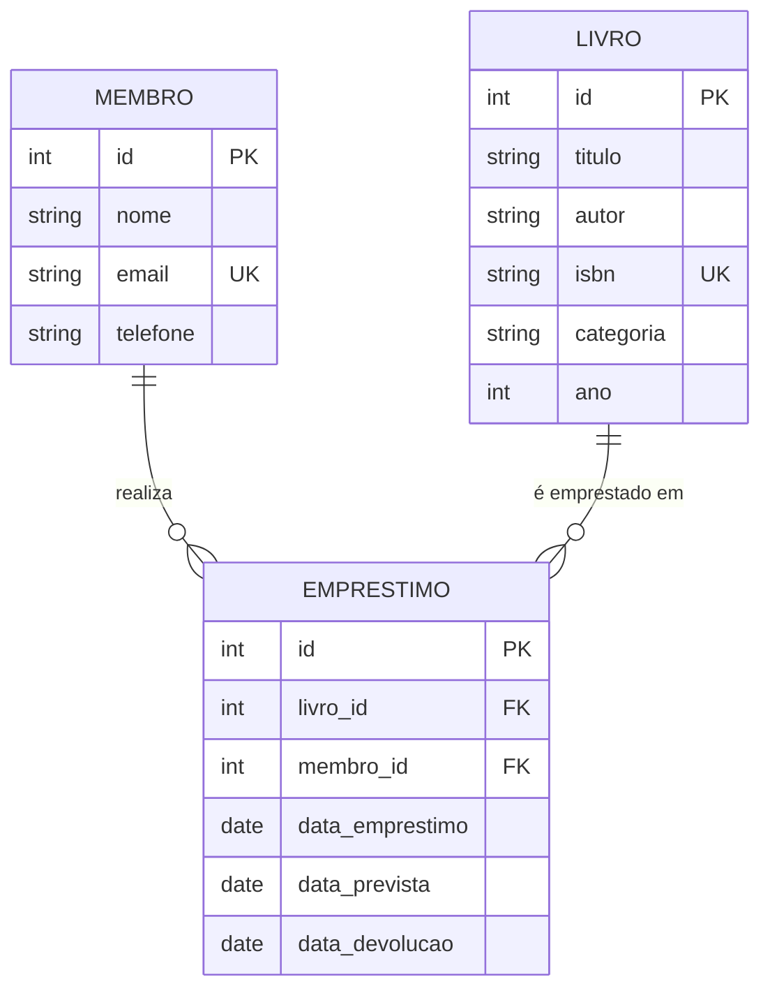

# 4. Banco de dados

## 4.1 Modelo conceitual (MER)


## 4.2 Modelo lógico
- `membros(id PK, nome, email UK, telefone, criado_em)`
- `livros(id PK, titulo, autor, isbn UK parcial, categoria, ano, criado_em)`
- `emprestimos(id PK, livro_id FK→livros, membro_id FK→membros, data_emprestimo, data_prevista, data_devolucao, criado_em)`

Normalização: todas as tabelas em 3FN (sem dependências parciais ou transitivas; a situação "disponível/emprestado" é **derivada** do empréstimo em aberto, não armazenada).

## 4.3 Modelo físico
Ver [`db/schema.sql`](../db/schema.sql) (PostgreSQL). Decisões principais:

| Decisão | Motivo |
|---|---|
| `generated always as identity` | Chave primária automática, padrão SQL moderno |
| Índice único parcial `ux_emprestimo_livro_aberto` (livro com `data_devolucao is null`) | Garante RN01 no banco, mesmo se a tela falhar |
| `on delete restrict` nas FKs | Garante RN04 (preserva histórico) |
| Índice único `lower(email)` | E-mail único sem diferenciar maiúsculas |
| `check` em ISBN, ano e datas | Dados inválidos recusados no banco (RNF05) |
| View `vw_emprestimos_atrasados` | Consulta pronta de apoio para relatórios |
| Row Level Security com política `anon` aberta | Necessária para o front falar direto com o banco; ver limitação RNF06 |

## 4.4 Dicionário de dados
**membros**
| Coluna | Tipo | Regra |
|---|---|---|
| id | bigint | PK, automático |
| nome | varchar(120) | obrigatório, mínimo 3 caracteres |
| email | varchar(150) | obrigatório, único (sem diferenciar caixa) |
| telefone | varchar(11) | opcional, só dígitos com DDD |
| criado_em | timestamptz | padrão `now()` |

**livros**
| Coluna | Tipo | Regra |
|---|---|---|
| id | bigint | PK, automático |
| titulo | varchar(150) | obrigatório |
| autor | varchar(120) | obrigatório |
| isbn | varchar(13) | opcional; 10 ou 13 dígitos; único quando informado |
| categoria | varchar(60) | opcional |
| ano | smallint | opcional; entre 1400 e 2100 |
| criado_em | timestamptz | padrão `now()` |

**emprestimos**
| Coluna | Tipo | Regra |
|---|---|---|
| id | bigint | PK, automático |
| livro_id | bigint | FK livros, obrigatório |
| membro_id | bigint | FK membros, obrigatório |
| data_emprestimo | date | padrão hoje |
| data_prevista | date | obrigatório; ≥ data_emprestimo |
| data_devolucao | date | nula enquanto em aberto; ≥ data_emprestimo |
| criado_em | timestamptz | padrão `now()` |

## 4.5 Consultas relevantes (exemplos)
```sql
-- Livros disponíveis
select l.* from livros l
where not exists (select 1 from emprestimos e where e.livro_id = l.id and e.data_devolucao is null);

-- Empréstimos em atraso
select * from vw_emprestimos_atrasados order by dias_atraso desc;
```
